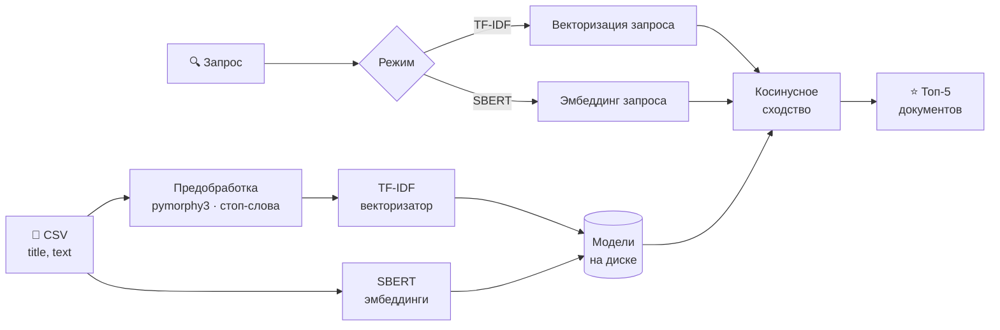

<div align="center">

# 🔎 RecommendationApp

**Рекомендательная система для текстовых документов на русском языке**

Загрузите свой датасет статей — и получайте релевантные рекомендации по любому запросу.<br>
Два алгоритма на выбор: классический **TF-IDF** и семантический **Sentence-BERT**.


[Возможности](#-возможности) •
[Быстрый старт](#-быстрый-старт) •
[Как это работает](#-как-это-работает) •
[API](#-api) •
[Структура](#-структура-проекта)

</div>

---

## ✨ Возможности

<table>
<tr>
<td width="50%" valign="top">

### 🧠 Два режима поиска
Переключатель на главной странице:

- **TF-IDF** — векторизация + косинусное сходство. Быстро, офлайн, без тяжёлых зависимостей.
- **Sentence Transformers** — семантические эмбеддинги `paraphrase-multilingual-mpnet-base-v2`. Понимает *смысл* запроса, а не только совпадение слов.

</td>
<td width="50%" valign="top">

### 📚 Рекомендации
- **Основной поиск** — топ-5 релевантных документов
- **Похожие статьи** — по клику на карточку
- **Вам также может быть интересно** — подборка на основе истории запросов *(для авторизованных)*

</td>
</tr>
<tr>
<td width="50%" valign="top">

### 👤 Профиль пользователя
- Регистрация и вход через сайдбар
- Токен-аутентификация
- Счётчик запросов и персональная история
- Каждый видит только свою историю

</td>
<td width="50%" valign="top">

### 🕘 История поиска
- Хранится в базе данных
- Клик по запросу — подставляет его в строку поиска
- Удаление отдельного запроса или всей истории

</td>
</tr>
</table>

---

## 🚀 Быстрый старт

### Требования

- Python 3.10+
- Node.js 18+
- ~400 МБ свободного места под SBERT-модель (скачивается один раз)

### 1. Клонирование

```bash
git clone https://github.com/Nist1/RecommendationAppProject.git
cd RecommendationAppProject
```

### 2. Backend

```bash
cd backend
pip install -r requirements.txt
pip install sentence-transformers
python manage.py migrate
```

### 3. Frontend

```bash
cd frontend
npm install
```

### 4. Запуск

Из корня проекта одной командой (бэкенд и фронтенд стартуют вместе через `concurrently`):

```bash
npm install
npm start
```

<details>
<summary>Или по отдельности</summary>

```bash
# терминал 1
cd backend && python manage.py runserver

# терминал 2
cd frontend && npm start
```

</details>

| Сервис   | Адрес                     |
|----------|---------------------------|
| Frontend | http://localhost:3000     |
| Backend  | http://127.0.0.1:8000     |

---

## 📂 Загрузка датасета

Нажмите **«Загрузить датасет»** и выберите CSV-файл с колонками `title` и `text`:

```csv
title,text
Заголовок статьи,Текст статьи...
```

> 💡 Для пробы можно взять `test_dataset.csv` из корня репозитория или `backend/data/raw/sample.csv`.

---

## ⚙️ Как это работает



При загрузке датасета автоматически:

1. **Предобработка** — лемматизация (pymorphy3) и удаление стоп-слов
2. **Обучение TF-IDF** векторизатора
3. **Построение SBERT-эмбеддингов** для всех документов

При поиске запрос проходит тот же путь и сравнивается с документами по косинусному сходству.

| | TF-IDF | Sentence Transformers |
|---|:---:|:---:|
| Скорость | ⚡ очень быстро | 🐢 медленнее |
| Понимание синонимов и смысла | ❌ | ✅ |
| Работает без интернета | ✅ | ✅ *(после первой загрузки)* |
| Размер модели | килобайты | ~400 МБ |

---

## 🔌 API

<details open>
<summary><b>Рекомендации</b></summary>

| Метод | Эндпоинт | Описание |
|:-----:|----------|----------|
| `POST` | `/api/upload/` | Загрузка датасета |
| `POST` | `/api/search/` | Поиск рекомендаций (`query`, `method`) |
| `POST` | `/api/similar/` | Похожие статьи по ID |
| `POST` | `/api/history-recs/` | Рекомендации по истории |

</details>

<details open>
<summary><b>Авторизация и история</b></summary>

| Метод | Эндпоинт | Описание |
|:-----:|----------|----------|
| `POST` | `/api/auth/register/` | Регистрация |
| `POST` | `/api/auth/login/` | Вход |
| `POST` | `/api/auth/logout/` | Выход |
| `GET`  | `/api/auth/me/` | Текущий пользователь |
| `GET`  | `/api/auth/history/` | История поиска |
| `POST` | `/api/auth/history/clear/` | Очистить историю |
| `POST` | `/api/auth/history/delete/` | Удалить один запрос |

</details>

---

## 🗂 Структура проекта

```
RecommendationApp/
├── package.json                      # npm start — запуск всего проекта
├── backend/
│   ├── config/                       # Настройки Django
│   ├── ml_engine/
│   │   ├── preprocessor.py           # Предобработка русского текста
│   │   ├── vectorizer.py             # TF-IDF векторизация
│   │   ├── recomendation.py          # Рекомендации через TF-IDF
│   │   ├── embedding_recommender.py  # Рекомендации через SBERT
│   │   └── process_pipeline.py       # Полный пайплайн обработки
│   ├── recs_api/
│   │   ├── models.py                 # SearchHistory, AuthToken
│   │   └── views.py                  # API-эндпоинты
│   └── requirements.txt
└── frontend/
    └── src/
        ├── App.js                    # Главный компонент
        ├── ResultCard.js             # Карточка результата
        └── ProfileSidebar.js         # Сайдбар профиля
```

---

## 🛠 Стек

| Слой | Технологии |
|------|-----------|
| **Backend** | Django 6.0, django-cors-headers, SQLite |
| **Frontend** | React 19, Axios, Ionicons |
| **ML / NLP** | scikit-learn, sentence-transformers, pymorphy3, NLTK, pandas, NumPy |
